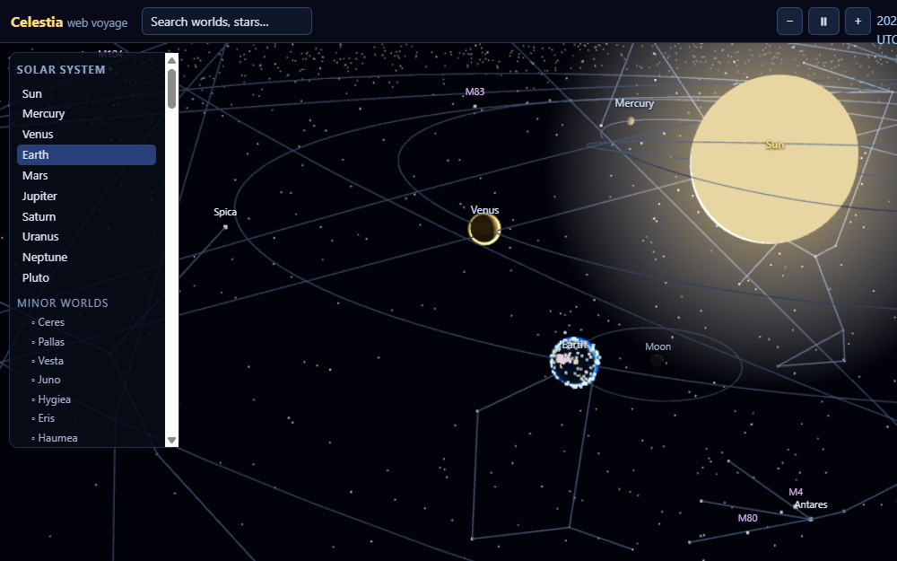
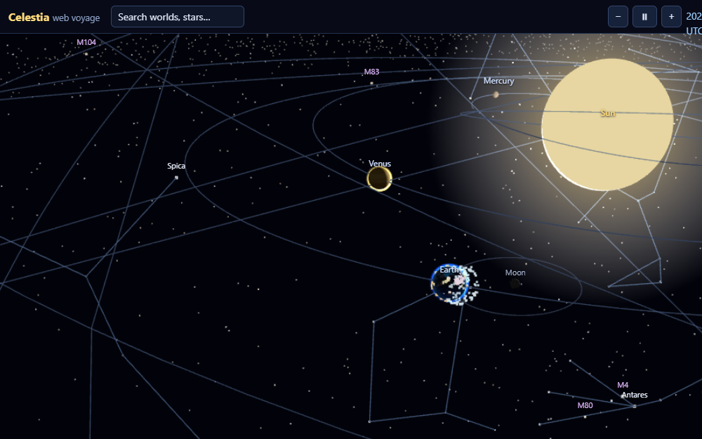
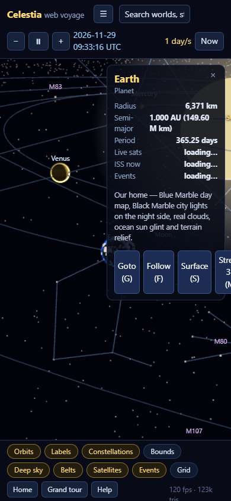

  
  <h1>Celesticus</h1>
  
<i>Apprendre en s'amusant / Learn while having fun</i>

  
<b>Catégorie :</b> Éducation

  <a href="https://T2Smart-AI.github.io/perchance-celesticus/">Démo Live</a> | <a href="showcase.html">Showcase</a>

  
  
  

---

## 🇫🇷 Français

### Description
Celesticus est un moteur d'exploration spatiale permettant de naviguer dans le système solaire et parmi les étoiles. Il utilise des éphémérides réelles, propose une accélération du temps (time warp) et inclut des visites guidées à travers les constellations.

### Fonctionnalités
- **Navigation Universelle :** Voyagez à travers l'espace avec le mode "Grand tour".
- **Données Astronomiques :** Visualisation des constellations, des ceintures d'astéroïdes, des objets du ciel profond et des satellites.
- **Outils de Précision :** Gestion du quadrillage (Grid), des bornes (Bounds) et des étiquettes (Labels).
- **Interface Interactive :** Panneaux de contrôle pour les événements célestes et la navigation urbaine (StreetCity).

### Contrôles
- **Souris/Pointer :** Navigation et interaction avec l'interface.
- **Clavier :** `Shift + Space` pour les commandes spécifiques.
- **Interface :** 
    - `☰` : Menu principal
    - `+` / `−` : Zoom
    - `⏸` : Pause du temps
    - `Go` / `Home` : Déplacement rapide
    - `⚄ City` / `◉ Here` : Localisation

### Démarrage Rapide
- **Windows :** Double-cliquez sur `start.cmd`.
- **macOS/Linux :** Exécutez `sh start.sh`.
- **Autre :** Lancez `python3 -m http.server` (un serveur HTTP est requis pour les modules ES).

### Personnalisation
| Variable | Valeur par défaut | Description |
| :--- | :--- | :--- |
| `appName` | Celestia Web | Nom de l'application |

### Structure du Projet
- `src/core/` : Logique principale (`main.js`).
- `src/celestia/` : Moteurs de calcul (`astro.js`, `data.js`, `events.js`) et rendu (`earth.js`, `textures.js`).
- `src/celestia/textures/` : Assets visuels (topographie, nuages, textures jour/nuit).

### Stack Technique
- **Rendu :** WebGL
- **Librairies :** Three.js (0.160.0), MapLibre GL

### Déploiement & Licence
- **Déploiement :** GitHub Pages.
- **Licence :** MIT.

---

## 🇺🇸 English

### Description
Celesticus is a space exploration engine allowing users to fly through the solar system and the stars. It features real ephemerides, time warp capabilities, and guided tours of the constellations.

### Features
- **Universal Navigation:** Explore the cosmos via the "Grand tour" mode.
- **Astronomical Data:** Visualization of constellations, asteroid belts, deep sky objects, and satellites.
- **Precision Tools:** Toggleable Grid, Bounds, and Labels for spatial orientation.
- **Interactive UI:** Dedicated panels for celestial events and urban mapping (StreetCity).

### Controls
- **Mouse/Pointer :** Navigation and UI interaction.
- **Keyboard :** `Shift + Space` for specific functions.
- **UI Buttons :** 
    - `☰` : Main Menu
    - `+` / `−` : Zoom
    - `⏸` : Time Pause
    - `Go` / `Home` : Fast travel
    - `⚄ City` / `◉ Here` : Location targeting

### Quickstart
- **Windows :** Double-click `start.cmd`.
- **macOS/Linux :** Run `sh start.sh`.
- **Other :**
